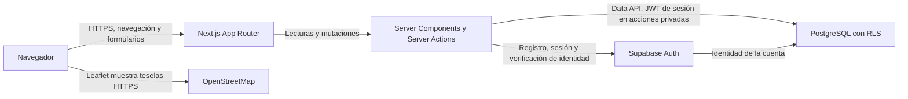

# Pregunta 3 · Arquitectura y ciclo DevSecOps

## 1. Arquitectura lógica

**Comparar precios.** El comprador abre `/productos` y busca «Manzanilla». El servidor valida la longitud y llama por la Data API a `buscar_ofertas` con texto parametrizado. PostgreSQL combina ofertas y puestos activos, aplica RLS y devuelve precio y disponibilidad ordenados de menor a mayor. El navegador recibe los resultados y enlaces a las fichas.

**Actualizar disponibilidad.** El hierbero envía el formulario de `/panel/hierbero`. La Server Action verifica la sesión, revisa que el rol sea de hierbero, valida los campos con Zod y escribe con el JWT del usuario. RLS comprueba que la oferta pertenezca al puesto de esa cuenta. En la próxima consulta pública, el comprador ve la oferta como agotada.

## 2. Ciclo DevSecOps

| Fase | Herramienta | Uso concreto | Control de seguridad | Evidencia |
| --- | --- | --- | --- | --- |
| Plan | Jira y CSV | Priorizar historias y definir aceptación | Cada HU incluye un criterio de seguridad | [Backlog](backlog.md) |
| Code | Git y GitHub | Asociar commits y PR a historias | Protección de ramas y revisión por PR | [Repositorio](https://github.com/ACaroMC/Proyecto3-PC2/pulls?q=is%3Apr) |
| Build | GitHub Actions y npm | Instalar desde el lockfile y compilar Next.js | Lockfile y permisos de lectura para el token | Job `ci` |
| Test | Vitest, PostgreSQL y Gitleaks | Validar entradas, ejecutar permisos por rol y escanear secretos | Auditoría npm y fallo ante RLS incorrecto | `supabase/tests/rls.sql` y job `seguridad` |
| Release | GitHub Actions | Identificar el commit con su SHA e historial de PR | El despliegue requiere CI y seguridad en verde | SHA de cada ejecución |
| Deploy | Supabase CLI y Vercel CLI | Aplicar migraciones y publicar el build desde `main` | GitHub Secrets y despliegue Git nativo desactivado | Job `deploy` |
| Operate | Vercel y Supabase Dashboard | Comprobar salud, datos y operación del catálogo | Separación de entornos y gestión administrativa controlada | `/api/health` y paneles |
| Monitor | GitHub Actions, Vercel Logs y Supabase Logs | Correlacionar errores, ejecución y despliegue | Buscar fallos de autorización y revisar accesos de la base | Historial de ejecución y logs por intervalo |

Para operar, revisa `/api/health`, el directorio y la comparación después de publicar. Ante un fallo, identifica el SHA y el job fallido en Actions, revisa Runtime Logs en Vercel y los logs de API, Auth y Postgres en Supabase. Para revertir la aplicación, promueve desde Vercel un despliegue anterior compatible con el esquema actual y abre un PR de corrección. Para revertir un cambio de datos, prepara una migración compensatoria y prueba su efecto con una copia antes de aplicarla.

## 3. Justificación del stack

- **Next.js y TypeScript** reúnen navegación pública, renderizado y mutaciones privadas en un mismo repositorio y permiten comprobar tipos antes del despliegue.
- **Zod** valida campos comerciales, moneda, coordenadas y permisos esperados en el límite de las Server Actions. Las restricciones SQL cubren las escrituras que llegan por otra vía.
- **Supabase Auth y PostgreSQL** reutilizan cuentas, JWT y una base relacional administrada. Las relaciones entre productos, comercios y fichas conservan integridad y RLS protege las escrituras por dueño o rol.
- **Leaflet y OpenStreetMap** permiten marcar ubicaciones y navegar a fichas sin operar un servidor de mapas para el examen. Cada mapa muestra la atribución y las fichas conservan su dirección escrita.
- **Jira, GitHub y GitHub Actions** permiten repartir el trabajo, seguir una HU al PR y reproducir las verificaciones desde el lockfile. **Vercel** publica Next.js y ofrece logs de la aplicación sin mantener un servidor propio.

## 4. Guion de exposición

> Raíz Perú ayuda a encontrar hierberos y comparar precios antes de ir a un mercado. En el diagrama, el navegador habla con Next.js. Allí están las páginas y las Server Actions. Para ver ofertas, Next.js consulta PostgreSQL en Supabase. Para editar, verifica primero la sesión y el rol. El mapa usa Leaflet y solicita las teselas a OpenStreetMap.
>
> Pensemos en HU-14. En Jira planteamos que el hierbero pueda marcar un producto como agotado. En el código, validamos el formulario con Zod y enviamos el cambio con la sesión de quien tiene el puesto. En la base, RLS comprueba la propiedad. La prueba ejecuta la actualización como hierbero y la consulta como comprador para confirmar que se ve el cambio. El PR pasa por GitHub Actions, que compila, prueba y escanea. En main, el pipeline migra y despliega. Si aparece un problema, podemos seguir el SHA y revisar los logs o revertir una versión compatible.
